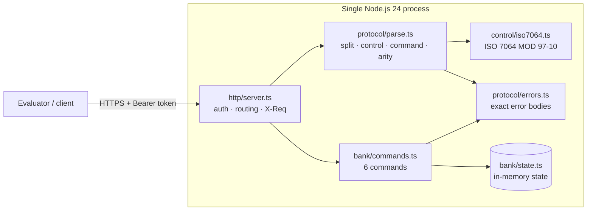

# System Design — Reto 2 "La caja negra" replica

Replacement for an undocumented legacy service. The replica must return the same HTTP status and body as the
original for every request, errors included (README.md:3-5, README.md:104-114).

Evidence references: `E:n` = line n of `pruebas/ejemplos.jsonl`; `X:n` = line n of `experimentos.jsonl`.
Confidence labels follow README.md:84-87: **confirmed** (tested and repeated), **probable** (seen once or inferred),
**assumption** (untested; the replica's chosen default).

## 1. Architecture



Dependency rule: `control` and `bank` are pure (no I/O); `protocol` depends on `control`; `http` is the only
adapter and orchestrates the rest. Zero runtime dependencies.

## 2. Request flow — `POST /msg`

```mermaid
sequenceDiagram
  participant C as Client
  participant H as http/server
  participant P as protocol/parse
  participant B as bank/commands
  C->>H: POST /msg {"m":"CMD;args;control"}
  H->>H: known route (GET /health, POST /__reset, POST /msg)? else 404 E404
  H->>H: Authorization == "Bearer TEAM_TOKEN"? else 401 E001 (no X-Req)
  H->>H: X-Req += 1; body JSON? else 400 E100; string m? else 400 E102
  H->>P: parseMessage(m)
  P-->>H: E201 / E202 / E301 / E302, or {command, args}
  H->>B: execute(state, command, args)
  B-->>H: {status, body}
  H-->>C: status + JSON body + X-Req header
```

## 3. Components

| Component | Responsibility |
|---|---|
| `src/control/iso7064.ts` | Control value: uppercase payload; digits kept, letters A=1..Z=26 (no padding), other chars dropped; `98 − (N·100 mod 97)`, computed by streaming mod. |
| `src/protocol/parse.ts` | Splits `m` on `;`, last field = control; validates control format, control value, command (case-insensitive), arity. |
| `src/protocol/errors.ts` | Single catalog of error statuses and byte-exact bodies. |
| `src/bank/state.ts` | Accounts, operations, `AC`/`OP` counters, reset. |
| `src/bank/commands.ts` | PING, ALTA, CONSULTA, DEPOSITO, TRANSFER, ANULA. |
| `src/http/server.ts` | `node:http` adapter: auth, routes (`/health`, `/__reset`, `/msg`), `X-Req` counter. |
| `src/main.ts` | Reads `TEAM_TOKEN` (required) and `PORT` (default 3000); listens on `0.0.0.0`. |

## 4. State model (in memory, no persistence)

| Element | Behavior | Confidence / evidence |
|---|---|---|
| Accounts `AC-NNNN` | Sequential from `AC-0001`, 4-digit zero padding, start at balance 0 | confirmed — E:3, E:4, E:5, X:3, X:5 |
| Operations `OP-NNNN` | Shared sequence for DEPOSITO and TRANSFER | observed — E:6, E:7, E:10, E:18 |
| Rejected requests | Do not consume `AC`/`OP` numbers | confirmed — E:2→E:3, X:4→X:5; E:9→E:10 |
| ANULA | Does not consume an `OP` number; second ANULA → `ok:false` | observed — E:13, E:14, E:18 |
| ANULA of TRANSFER | Debits destination | observed — E:19 (40700 = 40000 + 700) |
| ANULA credits origin; ANULA of DEPOSITO debits account; negative balances allowed | — | **assumption** |
| `X-Req` | Counter of authorized `/msg`, errors included; **not** reset by `POST /__reset` | probable — X:2–X:6 (1..5), X:18→X:19 (9→10 across a reset); headers are not compared (README.md:117) |
| `POST /__reset` | Clears accounts, operations and `AC`/`OP` counters → `200 {"ok":true}` | observed — reset output of the s-ctl-01, s-io-01 and s-amt-01 runs (not logged as lines); X:19 restarts at `AC-0001` |

State lives in one process; a restart loses it. This is acceptable because every evaluation test starts with
`POST /__reset` (README.md:44, README.md:107).

## 5. Authentication, validation and errors

Order (step 0 observed in X:12; steps 3–6 are an **assumption**: the cancelled experiment s-ord-01 never ran; E:12 and E:20
carry valid controls, so they do not reveal the order):

| Step | Check | Error | Evidence |
|---|---|---|---|
| 0 | Known route and method | 404 `E404` "ruta desconocida", even without token | observed — X:7–X:9, X:12 |
| 1 | Bearer token (all known routes, `/health` included) | 401 `E001` "no autorizado" | observed — X:1, X:11 (wrong token), X:10 (missing), X:13 (`/health`) |
| 2 | JSON body / string `m` | 400 `E100` "json inválido" / 400 `E102` "falta m" | observed — X:15 / X:16, X:17 |
| 3 | Control is digits | 400 `E201` "control mal formado" | E:17 |
| 4 | Control matches ISO value | 400 `E202` "control inválido" | E:2; confirmed on edge residues X:3–X:6 |
| 5 | Known command | 400 `E301` "comando desconocido " (trailing space) | E:12 |
| 6 | Arity (PING 0, ALTA 1, CONSULTA 1, DEPOSITO 2, TRANSFER 3, ANULA 1) | 400 `E302` "aridad inválida" | E:20; arities from E:1–E:19 |
| 7 | Business rules | 404 `E401`, 422 `E506`, 422 `E507` | E:15, E:9, E:16 |

TRANSFER limit: `> 100000` per transfer, not cumulative — observed X:27 (100001 rejected), X:28–X:29 (100000 then
30000 accepted). E506 before E507 — observed X:30. Invalid amounts (0, negative, decimal, non-numeric) → 400
`E303` "monto inválido" — observed X:21–X:24, X:26. Unknown operation → 404 `E402` — observed X:18. Order of E401
vs E303 — **assumption**. `E500` (unexpected failure) is an **invented** placeholder.

## 6. Technical decisions

| Decision | Justification |
|---|---|
| Node.js 24 + TypeScript via native type stripping | Runs `.ts` without a build step (verified locally: `node probe.ts` → `ts-ok 42`). |
| `node:http`, zero runtime dependencies | Small surface, fast cold start, nothing to patch during the event. |
| Single in-memory state, one token (`TEAM_TOKEN`) | Evaluation talks to one process (README.md:135) and uses the team token (README.md:41-42). |
| Error catalog in one file; every unverified behavior tagged `// ASSUMPTION:` | Byte-exact bodies in one place; assumptions can be corrected in one line. |
| Golden tests replay `ejemplos.jsonl` and `experimentos.jsonl` | The recorded responses are the acceptance criteria (`npm test`: 11/11 pass). |
| No LLM inside the replica | Allowed (README.md:126) but unnecessary: behavior is deterministic. |
| Railway with Railpack, no Docker | Same platform as the original (README.md:11); no image to maintain; Node runs the sources directly. |
| Engineering contract in `AGENTS.md` | Verifiable rules (strict types, no casts in `src/`, no secrets, Definition of Done) for every agent. |

## 7. Deployment — exactly one instance

- Platform: Railway, Railpack builder, no Docker (`railway.json`): start `node src/main.ts`, no platform
  health check (see below), restart policy `ALWAYS`. Node pinned with `engines.node: 24.x`. Env: `TEAM_TOKEN` (service
  variable, never committed), `PORT` (set by the platform). Steps in `DEPLOY.md`.
- **One replica only**: several instances would each hold their own state (README.md:135-136). No autoscaling;
  replica count verified in the service settings before going live.
- Must stay warm: each step has 5 s to answer (README.md:117); platforms that sleep idle services are unsuitable.
- `GET /health` → `200 {"ok":true}` with the token (X:14) and `401 E001` without it (X:13), like the original. A
  platform health check cannot send the token, so none is configured.
- The replica never calls the original or another replica (README.md:125).

## 8. Risks, limitations, assumptions

| Risk | Impact | Mitigation |
|---|---|---|
| Validation order (steps 3–6) unverified | Multi-error requests may differ | Run experiment s-ord-01 (designed, 6 requests) |
| ANULA side effects on origin/deposits unverified | Sequences with ANULA + CONSULTA | Targeted experiment on ANULA |
| Service may change during the day (README.md:16, README.md:132) | Replica drifts from 20:00 version | Re-run golden checks against fresh recordings before 20:00 |
| In-memory state, restart loses data | Mid-sequence restart breaks a test | Single always-on instance; tests reset first |
| Inherited quirks (typo `recieved`, trailing space, `cuenta_id` vs `cuentaId`) | Must be kept for parity; a new client should not inherit them | Documented in the specification "Riesgos" section |
